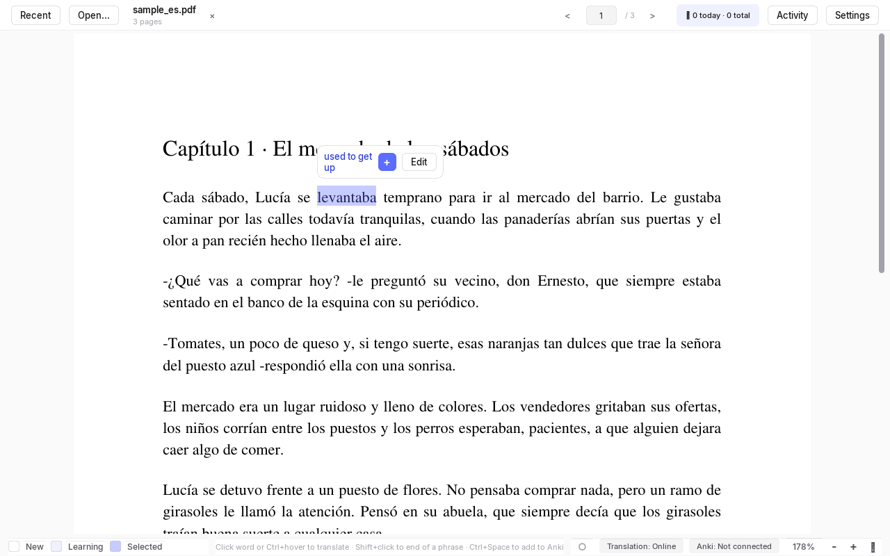
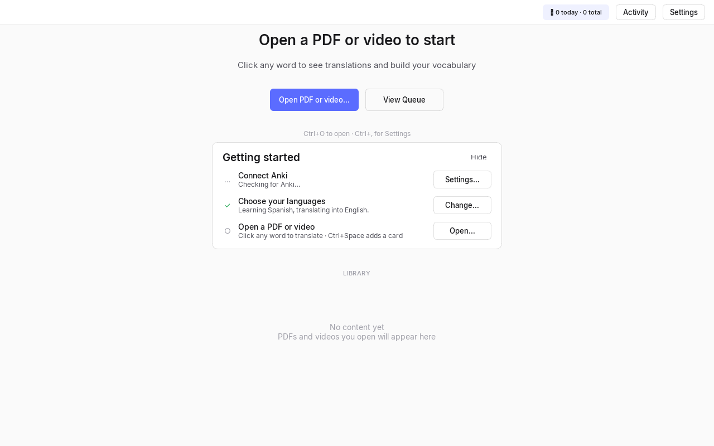
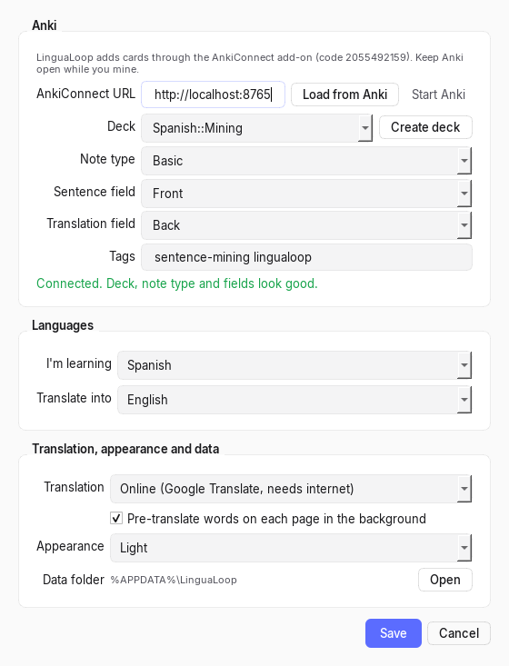
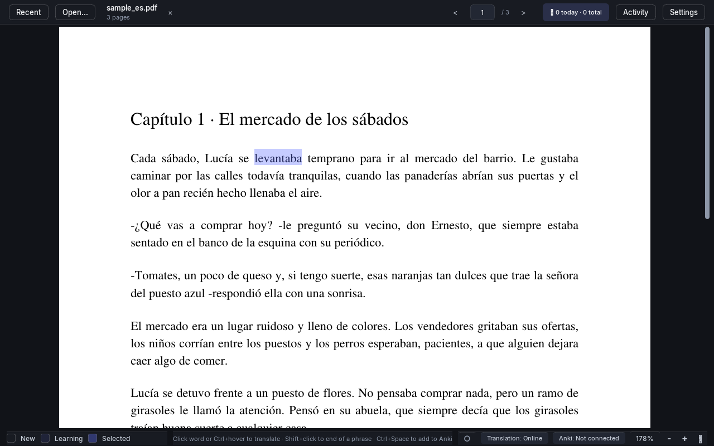

# Language Immersion Tools

Language Immersion Tools (LIT) is a free desktop app for immersion-based language learning according to methods like Refold.la (not affiliated). Open a PDF or subtitled video, click any word you don't know to see the translation, and automatically generate an Anki card with the target word, sentence context, and translation.

I initially built this for my own personal use. I found that I was wasting a lot of time while doing active immersion in ebooks or TV shows. When I found a word, I would have to stop, copy the word into Google Translate, then manually create an Anki card. I built this to consolidate and partially automate that workflow so I could spend more time actually immersing. LIT grew organically over time as I tweaked and added new features that I wanted, and I personally use it for immersion most days. 

Requests for new features are more than welcome! Please create an issue for this. An experimental branch will be used to contain all the niche features that I add for myself; you may use this branch if you'd like.

For the nerds, LIT also tracks analytics about your activity and progress - time spent actively using the app, total words mined, the relative frequency of those words (according to standard lists), etc. This is all stored locally for you to use as you please.



## Features

- PDF/EPUB reader. Click a word to translate it, Shift+click to translate phrase, or hold Ctrl and hover for a quick lookup. 
- Video player with clickable subtitles. Load an `.srt` file. Subtitles can be clicked and mined into Anki cards just like documents.
- Automated Anki card generation. Following the Refold method (refold.la/roadmap/library/sentence-mining), you can click "add to Anki" after translating a word or phrase to automatically generate an Anki card. The front of the card contains the sentence the word came from (dynamically detected by the app) with the target word highlighted, and the back shows the target word's translation.
- Online or offline translation. Uses Google Translate by default, or MarianMT models running locally if you install the offline extras.
- (Coming soon) Model Context Protocol support for LLM integration. Features TBD; will be fully optional.

Currently supports Spanish, French, Italian, Japanese, Chinese and English, in any combination.

## Install
A packaged installer is coming soon, but for now you will need to clone this repository and install from source. Your LLM of choice (ChatGPT, Claude, Gemini, Grok, etc.) can assist with this if needed.

### Requirements

- Anki desktop with the AnkiConnect add-on. In Anki go to *Tools → Add-ons → Get Add-ons…*, enter `2055492159`, and restart Anki.
- Python 3.11 or newer. 
- FFmpeg on your `PATH`. You only need this for generating subtitles or using the audio tools.

### Installing from from source

```bash
git clone https://github.com/ryanbowers166/language-immersion-tools.git
cd language-immersion-tools
python -m venv .venv
# Windows
.venv\Scripts\activate
# macOS / Linux
source .venv/bin/activate

pip install -r requirements.txt
```

There are two optional extras:

```bash
pip install -r requirements-offline.txt   # offline translation (MarianMT + PyTorch, several GB)
```

### Run

```bash
# Windows
run_lingualoop.bat
# any platform
python -m immersion_app.app
```

## First run

The welcome screen has a **Getting started** checklist that walks you through setup:



1. **Connect Anki.** Open Anki first, then go to **Settings** (Ctrl+,) → *Load from Anki*. Pick the deck you want cards to go to, the note type, and which fields should hold the sentence and the translation. By default it uses a deck called `LinguaLoop` with the built-in `Basic` note type (`Front` / `Back`). If the deck doesn't exist yet, *Create deck* will make it.
2. **Select native and target languages.** 



## Everyday use

| Action | How |
| --- | --- |
| Translate a word | Click it (PDF or subtitle) |
| Translate a phrase | Click the first word, Shift+click the last |
| Quick lookup (PDF) | Hold Ctrl and hover |
| Add the selection to Anki | Ctrl+Space (or Ctrl+Enter, or the **+** in the popover) |
| Queue it for later | Ctrl+Shift+Enter |
| Open a PDF or video | Ctrl+O |
| Load subtitles for the video | Ctrl+L |
| Previous / next page (PDF) | ← / → |
| Play / pause, seek 5 s (video) | Space, ← / → |
| Shift subtitles ±0.5 s | Ctrl+← / Ctrl+→ |
| Zoom in / out / fit width (PDF) | Ctrl+= / Ctrl+- / Ctrl+0 |
| Subtitle size (video) | Ctrl+= / Ctrl+- |
| Fullscreen | F11 or F |
| Close the translation popover | Esc |
| Settings | Ctrl+, |

If Anki isn't running when you add a card, it goes into a queue so you don't lose it. Once Anki is open, go to **View Queue → Process Queue** to send everything.

The dot in the status bar fills in (●) when study time is being counted. It counts while LinguaLoop is the active window and you've touched the mouse or keyboard in the last 2 minutes, or while a video is playing. Otherwise it pauses.



## Online vs offline translation

- **Online** is the default. It uses Google Translate through [`googletrans`](https://pypi.org/project/googletrans/), which is an unofficial library. It needs internet and sends the words you look up to Google, and since it's unofficial it sometimes breaks or gets rate limited. If that happens, turn off *Pre-translate words on each page* in Settings or switch to offline.
- **Offline** uses [MarianMT](https://huggingface.co/Helsinki-NLP) models through Hugging Face Transformers. Install `requirements-offline.txt` first. The first time you use a language pair it downloads that model (a few hundred MB). After that everything stays on your computer.

You can switch in Settings or by clicking the *Translation* badge in the status bar.

## Where your data lives

Settings, the card queue, study history and logs are all stored in a per-user folder:

- Windows: `%APPDATA%\LinguaLoop`
- macOS: `~/Library/Application Support/LinguaLoop`
- Linux: `~/.local/share/LinguaLoop`

*Settings → Data folder → Open* will open it for you. If you want it somewhere else (like a synced folder or a thumb drive), set the `LINGUALOOP_DATA_DIR` environment variable. If you're upgrading from an older version that kept data in the repo's `data/` folder, it gets copied over automatically the first time you launch.

## Companion tools

There are also some command-line tools in `src/immersion_app/cli`. Run them with `src` on your `PYTHONPATH`:

```bash
python -m immersion_app.cli.queue                                    # send queued cards to Anki
python -m immersion_app.cli.subtitles --mode folder --video-folder videos -l es   # Whisper subtitles for a folder
python -m immersion_app.cli.audio "https://youtube.com/watch?v=..."  # download/extract audio
python -m immersion_app.cli.analyze books --types srt pdf            # word-frequency analysis
```

`auto_miner.py` is a terminal tool for mining a batch of words at once. Make a markdown file with words listed under `# <source>` headers, where the source is a PDF, an SRT file or a web URL. It finds each word in its source, lets you pick the example sentence and adjust how much context to include, and then makes the cards.

```bash
python auto_miner.py [INPUT_FILE] [--deck "My Deck"] [--source-lang es] [--target-lang en]
```

By default it reads `automine_inputs.md` from the data folder. You can point it at a different file with `LINGUALOOP_AUTOMINE_FILE` if you'd rather keep your word list in a notes app. The terminal UI only works on Windows for now.

`scripts/` has a couple other utilities: a vocabulary counter and an AV1→H.264 video converter.

## Troubleshooting

- **Anki says "Not connected."** Make sure Anki is open and AnkiConnect is installed (code `2055492159`), then click the badge to check again. If Anki is running but your deck or note type is missing, the checklist and Settings will tell you which one.
- **Translations fail or say "rate limited" (HTTP 429).** Google is throttling the unofficial API. Turn off pre-translation in Settings and wait a while, or switch to offline translation.
- **A video won't play.** LinguaLoop uses Qt's FFmpeg backend, and some AV1 and HEVC files won't play with it. Convert them to H.264 first (`scripts/convert_to_h264.ps1` does this on Windows).
- **Logs** are in the data folder under `logs/`, one file per session. If you open an issue, attaching the log helps a lot.

## Contributing

Bug reports and PRs are welcome! Check out [CONTRIBUTING.md](CONTRIBUTING.md) for setup, tests and an overview of how the code is organized.

## License

LinguaLoop is free software under the [GNU General Public License v3.0](LICENSE).

It's built on [PySide6/Qt](https://www.qt.io/qt-for-python) (LGPL-3.0), [PyMuPDF](https://pymupdf.readthedocs.io/) (AGPL-3.0) and [googletrans](https://pypi.org/project/googletrans/) (MIT), plus [Transformers](https://github.com/huggingface/transformers)/[PyTorch](https://pytorch.org/) and [Whisper](https://github.com/openai/whisper) if you install the extras. It bundles the [Inter](https://rsms.me/inter/) typeface (SIL Open Font License 1.1, see `src/immersion_app/gui/fonts/OFL.txt`). LinguaLoop isn't affiliated with Anki or AnkiConnect.

Please only use it with books and videos you have the right to use. The repo doesn't include any.
